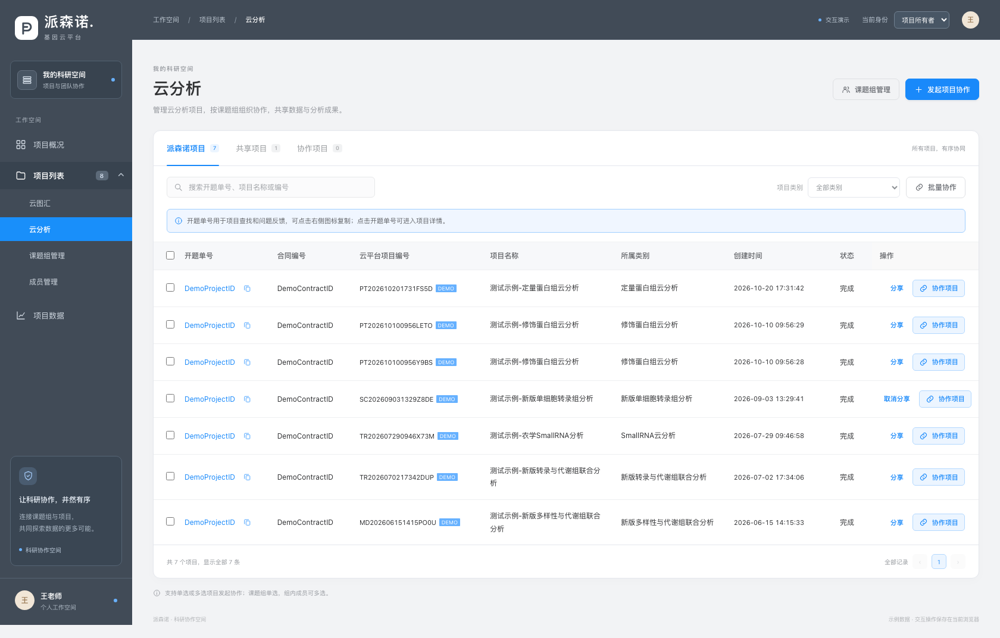
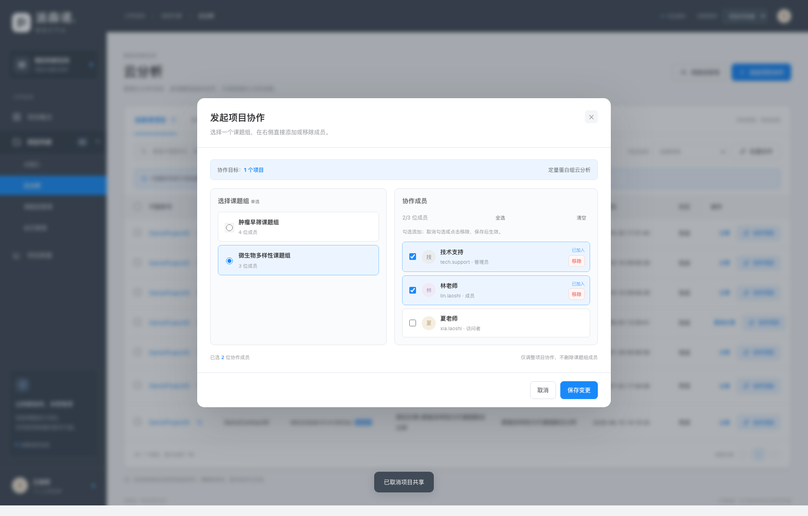

# 派森诺 · 科研协作空间

[打开在线交互原型](https://dafeiww.github.io/project-collaboration-prototype/?v=20261026-member-removal)

2026年10月26日更新。按参考截图采用深灰蓝导航与蓝色操作色。项目、课题组、成员页面不再显示顶部统计看板，保留业务列表和交互功能；桌面与手机均可体验。

## 可以体验的功能

- 左侧目录：项目列表为可展开父目录，二级依次为云图汇、云分析、课题组管理、成员管理。
- 项目列表：云图汇和云分析展示各自项目，均包含派森诺项目、共享项目、协作项目三个页签；按名称、编号搜索或按项目类别筛选。
- 项目字段：开题单号、合同编号、云平台项目编号、项目名称、所属类别、完整创建时间、状态；操作栏保留分享和协作项目，开题单号可复制或点击进入详情。
- 协作列表：与派森诺项目展示相同的七个业务字段，不显示操作列；点击开题单号或项目名称进入详情。
- 详情按入口区分：统一展示项目信息、查看结果、云盘下载提示及项目数据；只有从协作项目列表进入的详情额外包含“项目协作”。返回列表时保留来源页签。
- 协作成员管理：移至协作项目详情，按当前课题组的协作记录展示成员，支持新增、调整角色和移除；移除不影响其他课题组。
- 项目数据：支持示例文件夹的新建、名称校验、子目录浏览与确认删除；结果预览和客户端下载入口明确标注演示限制，不伪造分析文件或安装包。
- 项目协作：支持单项目和批量项目，单选课题组后展示对应成员，可多选组内成员；确认后在协作项目列表生成记录。
- 协作成员：在右侧同一份课题组成员名单中新增、移除或撤销，不再显示底部重复名单；保存后生效，取消不会修改记录，也不会删除课题组成员。技术支持固定为管理员。
- 课题组：填写名称，按姓名或账号搜索多选成员；可当场添加新成员，无需离开当前页面，返回保留组名、成员选择及角色。技术支持固定为管理员。
- 两处添加成员共用同一手机号核验弹窗：输入注册手机号，自动匹配演示云平台账号，再确认添加；支持格式、不匹配及重复校验、返回修改。成员库不设置项目角色，加入课题组时再指定角色。
- 成员库移除：新增操作列和“移除成员”。未关联成员须确认后移除；有关联课题组、项目、协作授权或分享权限的成员，展示关联明细并禁止移除。项目所有者受保护，普通成员和访问者不可操作。仅移出成员库，不删除示例平台注册账号，刷新后仍可按原手机号重新添加。
- 项目共享：仅在派森诺项目列表发起或取消共享。分享弹窗可按平台用户名添加和移除用户，最多五人；校验无效账号、重复用户与项目所有者，取消弹窗不提交修改。已分享项目单独显示“取消分享”，二次确认后收回分享权限，不影响协作关系。
- 身份切换：体验项目所有者、管理员、成员、访问者的不同管理权限。
- 项目概况、项目数据和项目详情：均采用可操作页面，无截图覆盖区域。

## 使用说明

选择项目 → 发起项目协作 → 单选已有课题组或当场新建 → 确认成员 → 保存变更。

协作弹窗内可直接新建课题组，建组时可添加新成员，无需先去成员管理。创建后自动选用新组，确认协作前不授予项目权限。新协作默认全选组员；已有协作保留原授权，后续加组员不会自动扩大旧项目权限。

在课题组列表发起协作时，也可以在弹窗中单选或多选目标项目。

已在成员库的示例手机号：`13800000005`（夏老师）。尚未入库的演示平台注册账号：`13800000007`（赵研究员）、`13800000008`（孙研究员）、`13800000009`（吴研究员），可体验账号匹配和新增流程。均为本地演示数据，不调用真实平台注册信息。

这是使用示例数据的前端交互原型。演示操作保存在当前浏览器，各体验者之间互不影响，不会修改真实平台数据。

## 预览

## 本地打开与发布

直接用浏览器打开 `index.html`，或打开目录中的单文件 `项目协作-可转发原型.html`。

线上站点的实际发布来源为本仓库 **main 分支根目录**。修改后将 `index.html`、`styles.css`、`script.js` 提交至 main，等待页面构建完成并核对在线版本。

## 验证

本次更新已通过浏览器实际点击验证，详见 [成员移除验收记录](成员移除验收记录.md)、[成员与建组流程验收记录](成员与建组流程验收记录.md) 和 [分享与详情验收记录](分享与详情验收记录.md)。前两轮验收记录保留作为版本历史。
