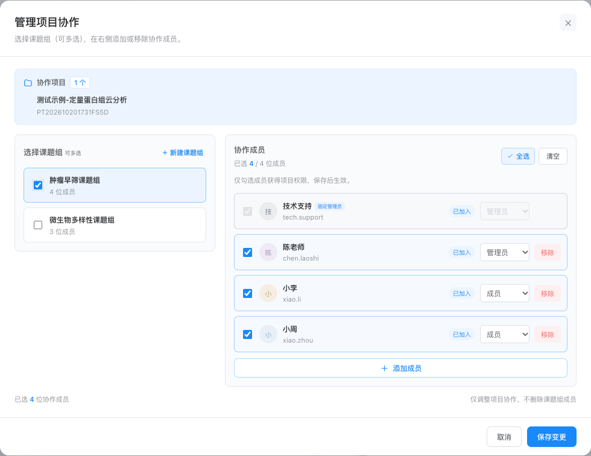
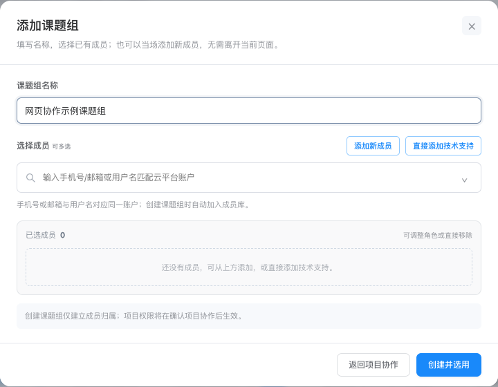
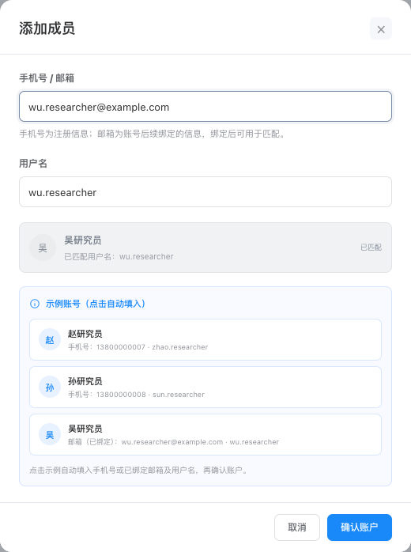
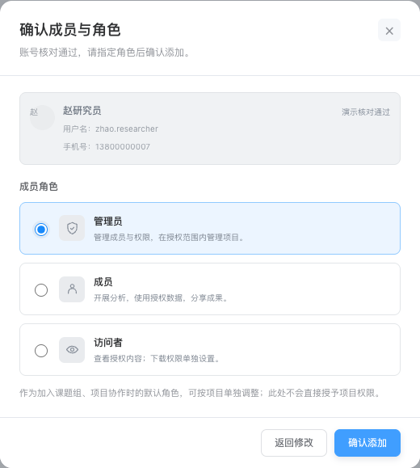
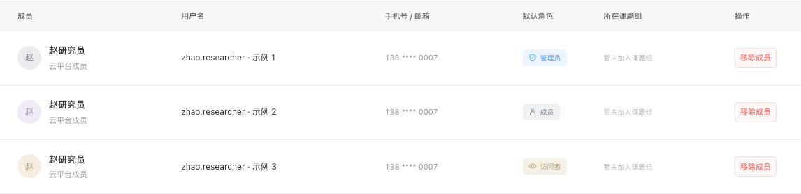

# 派森诺 · 科研协作空间

[打开在线网页原型](https://dafeiww.github.io/project-collaboration-prototype/?v=20261029-collaboration-team)

2026年10月29日更新。面向电脑浏览器的交互原型，沿用深灰蓝导航与蓝色操作色，统一项目协作、添加课题组、添加成员等网页弹窗。

## 本次样式优化

- 课题组选项按实际内容定高，列表从顶部紧凑排列，不再随右侧成员区域拉伸。
- 协作弹窗顶部显示所选项目的完整名称、编号及数量，支持单项目和多项目。
- “全选／清空”为28像素高的小操作按钮；新增成员和技术支持使用同一行的蓝色线框按钮。
- 弹窗统一标题、正文、边框、圆角和间距；较矮屏幕只滚动正文，取消与保存按钮保持可见。
- 中文版成员添加只有“手机号 / 邮箱”和“用户名”两个输入框：手机号为注册信息，邮箱为后续绑定信息，已绑定后才能用于匹配。英文版成员核对固定使用“邮箱 + 用户名”，不要求手机号。
- 操作列表头与按钮统一左对齐。技术支持在协作弹窗中固定选中且不显示移除按钮。

## 主要流程

1. 在云分析或云图汇的“派森诺项目”列表选择一个或多个项目。
2. 点击“发起项目协作”，选择一个或多个课题组；也可以在弹窗中直接新建课题组、添加成员。
3. 确认成员及角色后保存。同一项目可以对应不同课题组，多个项目也可以批量协作。
4. 顶部切换“被分享用户”，可查看收到的项目和成员信息；接收方没有添加、调整角色、移除等管理操作。

已协作项目可在详情的“项目数据”旁查看“协作列表”，未协作项目隐藏该页签。管理者和技术支持维护自己有管理权限的项目。

成员管理支持移除未参与协作项目或项目分享的成员，所属课题组本身不阻止移出成员库。移除须确认，平台示例账号保留，可再次添加；项目所有者受保护。

中文版项目分享支持按手机号、已绑定邮箱或用户名匹配已有账户，最多选择5位用户。取消全部分享需要确认，不影响协作授权。列表支持搜索、类别筛选、复制开题单号，以及进入项目数据与结果预览。

## 演示账户

| 用户名 | 示例手机号 | 邮箱与绑定状态 |
| --- | --- | --- |
| zhao.researcher | 13800000007 | zhao.researcher@example.com（已绑定） |

添加成员弹窗只展示赵研究员这一份示例。点击示例自动填入，或填写上述手机号／已绑定邮箱与用户名，均可反复添加同一个人，不设演示次数限制。每次确认生成独立成员记录，并标记“示例 1、示例 2……”；可分别设置角色、选择、移除，刷新后仍可继续添加。

成员管理、课题组添加、创建课题组内添加、项目详情添加，以及协作弹窗内添加使用同一套演示逻辑。重复添加仅放开这一示例账号；其他账户仍执行唯一匹配和防重复校验。这是本地原型的演示能力，不代表正式平台允许创建重复账户。

## 添加成员并指定角色

所有添加入口统一为“匹配账户 → 指定角色 → 确认添加”，可选择管理员、成员、访问者；技术支持固定为管理员。返回修改账号后，再次匹配同一账户会保留刚才选择的角色。

成员管理添加时保存默认角色，并在列表显示；从已有成员选择加入课题组时自动带入默认角色，也可单独调整。课题组内新增成员会按当场选择的角色加入当前课题组；项目详情和协作弹窗新增成员会使用所选项目角色。角色只在相应课题组／项目授权内生效，成员库的默认角色不会自动授予任何项目权限。重复示例的角色分别保存，刷新后不会互相覆盖。

角色流程验证见 [添加成员指定角色验收](20261029-添加成员指定角色验收记录.md)。

使用本地演示账户，不连接真实平台。交互操作只保存在当前浏览器，不同体验者之间互不影响。

## 网页弹窗预览

## 本地打开与发布

网页入口为 `index.html`。单文件 `项目协作-可转发原型.html` 可下载转发、直接在浏览器打开。

修改网页后运行 `python3 build-standalone.py` 同步两个单文件版本。GitHub Pages 发布来源为本仓库 **main 分支根目录**，提交并推送后等待构建完成。

本次浏览器流程验证见 [网页弹窗验收记录](20261029-网页弹窗验收记录.md)。此前验收记录保留作为版本历史。

## 2026年10月29日账户规则补充

中文版不提供“手机号版／邮箱版”切换按钮。用户在同一个联系信息输入框填写注册手机号或后续已绑定邮箱，再核对同一账户的用户名。系统不再为缺失邮箱的账户拼出示例邮箱；旧版自动生成的邮箱不会被当作已绑定邮箱。成员搜索、课题组选择和项目分享按同一绑定状态匹配。

英文版的成员信息规则随页面语言启用，固定为邮箱和用户名两个字段，允许没有手机号的账户。上述规则的验证记录见 [账户绑定规则验收](20261029-账户绑定规则验收记录.md)。

## 项目列表与团队管理更新

- 保留派森诺项目和共享项目，协作项目并入派森诺项目，开题单号后显示拥有者／协作者／访问者。
- 操作列协作在前、分享在后；支持去协作、编辑、取消、重新协作。取消不影响分享和成员库。
- 技术支持只展示受邀项目；成员管理、课题组管理合并为同页页签，成员在前。
