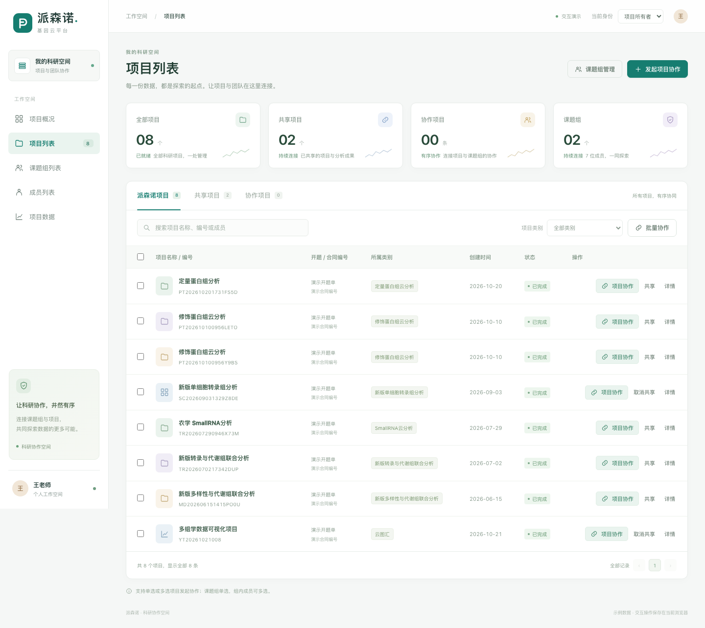

# 派森诺 · 科研协作空间

[打开在线交互原型](https://dafeiww.github.io/project-collaboration-prototype/?v=20261026)

2026年10月26日更新。白色侧边栏、青绿色视觉体系、项目统计卡片、统一表格和协作弹窗；桌面与手机均可体验。

## 可以体验的功能

- 项目列表：派森诺项目、共享项目、协作项目三个页签；按名称、编号搜索或按项目类别筛选。
- 项目协作：支持单项目和批量项目，单选课题组后展示对应成员，可多选组内成员；确认后在协作项目列表生成记录。
- 协作成员：新增、移除、调整角色，技术支持固定为管理员；移除操作保存后生效，取消不会修改记录。
- 课题组：填写名称、添加成员、设置角色；可在列表中直接添加技术支持。
- 成员列表：添加人员，校验姓名、账号、手机号和重复记录；刷新后保留新增人员。
- 项目共享：仅在派森诺项目列表发起或取消共享；共享项目页签展示对应项目。
- 身份切换：体验项目所有者、管理员、成员、访问者的不同管理权限。
- 项目概况、项目数据和项目详情：均采用可操作页面，无截图覆盖区域。

## 使用说明

选择项目 → 发起项目协作 → 单选课题组 → 勾选成员 → 保存变更。

在课题组列表发起协作时，也可以在弹窗中单选或多选目标项目。

成员邀请的演示手机号为 `13800000005`（夏老师）；也可以先在成员列表添加人员，再输入其手机号邀请。

这是使用示例数据的前端交互原型。演示操作保存在当前浏览器，各体验者之间互不影响，不会修改真实平台数据。

## 预览

## 本地打开与发布

直接用浏览器打开 `index.html`，或打开目录中的单文件 `项目协作-可转发原型.html`。

线上站点的实际发布来源为本仓库 **main 分支根目录**。修改后将 `index.html`、`styles.css`、`script.js` 提交至 main，等待页面构建完成并核对在线版本。

## 验证

已通过浏览器实际点击验证，详见 [验收记录](验收记录.md)。
