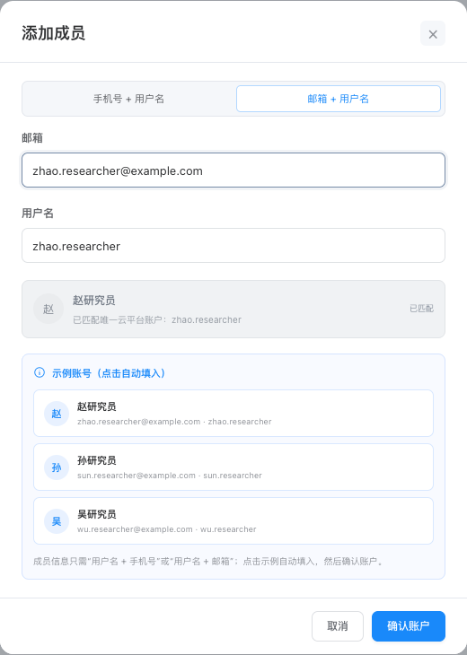

# 派森诺 · 科研协作空间

[打开在线网页原型](https://dafeiww.github.io/project-collaboration-prototype/?v=20261029-web-dialogs)

2026年10月29日更新。面向电脑浏览器的交互原型，沿用深灰蓝导航与蓝色操作色，统一项目协作、添加课题组、添加成员等网页弹窗。

## 本次样式优化

- 课题组选项按实际内容定高，列表从顶部紧凑排列，不再随右侧成员区域拉伸。
- 协作弹窗顶部显示所选项目的完整名称、编号及数量，支持单项目和多项目。
- “全选／清空”为28像素高的小操作按钮；新增成员和技术支持使用同一行的蓝色线框按钮。
- 弹窗统一标题、正文、边框、圆角和间距；较矮屏幕只滚动正文，取消与保存按钮保持可见。
- 成员添加支持“手机号 + 用户名”或“邮箱 + 用户名”两种方式，每次只显示两个字段；输入任一信息匹配唯一账户，底部提供可点击示例。
- 操作列表头与按钮统一左对齐。技术支持在协作弹窗中固定选中且不显示移除按钮。

## 主要流程

1. 在云分析或云图汇的“派森诺项目”列表选择一个或多个项目。
2. 点击“发起项目协作”，选择一个或多个课题组；也可以在弹窗中直接新建课题组、添加成员。
3. 确认成员及角色后保存。同一项目可以对应不同课题组，多个项目也可以批量协作。
4. 顶部切换“被分享用户”，可查看收到的项目和成员信息；接收方没有添加、调整角色、移除等管理操作。

已协作项目可在详情的“项目数据”旁查看“协作列表”，未协作项目隐藏该页签。管理者和技术支持维护自己有管理权限的项目。

成员管理支持移除未参与协作项目或项目分享的成员，所属课题组本身不阻止移出成员库。移除须确认，平台示例账号保留，可再次添加；项目所有者受保护。

项目分享支持按手机号、邮箱或用户名匹配已有账户，最多选择5位用户。取消全部分享需要确认，不影响协作授权。列表支持搜索、类别筛选、复制开题单号，以及进入项目数据与结果预览。

## 演示账户

| 用户名 | 示例手机号 | 示例邮箱 |
| --- | --- | --- |
| zhao.researcher | 13800000007 | zhao.researcher@example.com |
| sun.researcher | 13800000008 | sun.researcher@example.com |
| wu.researcher | 13800000009 | wu.researcher@example.com |

使用本地演示账户，不连接真实平台。交互操作只保存在当前浏览器，不同体验者之间互不影响。

## 网页弹窗预览

## 本地打开与发布

网页入口为 `index.html`。单文件 `项目协作-可转发原型.html` 可下载转发、直接在浏览器打开。

修改网页后运行 `python3 build-standalone.py` 同步两个单文件版本。GitHub Pages 发布来源为本仓库 **main 分支根目录**，提交并推送后等待构建完成。

本次浏览器流程验证见 [网页弹窗验收记录](20261029-网页弹窗验收记录.md)。此前验收记录保留作为版本历史。
