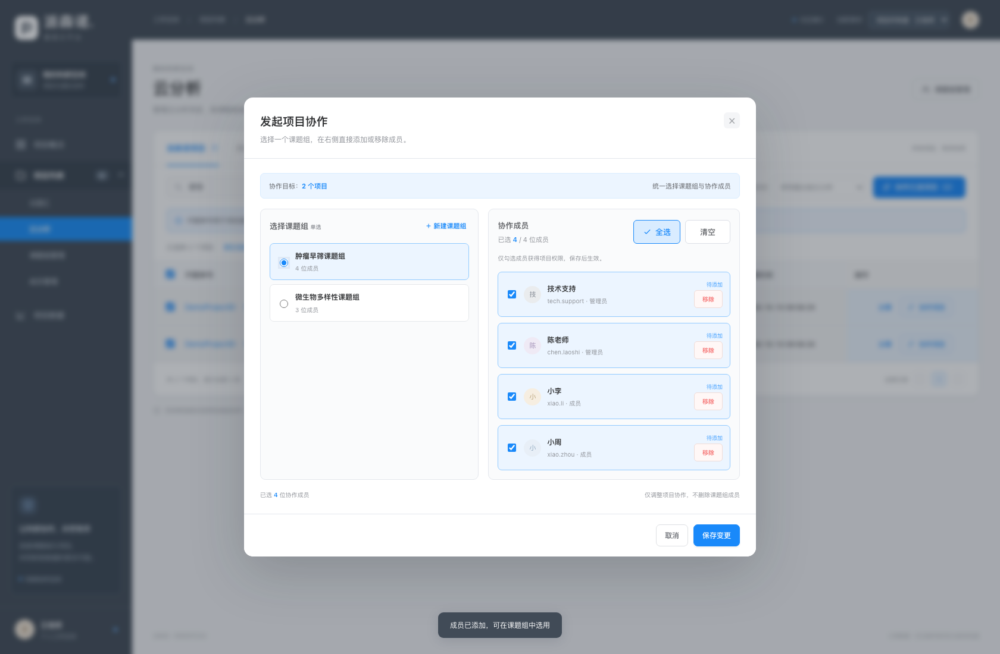
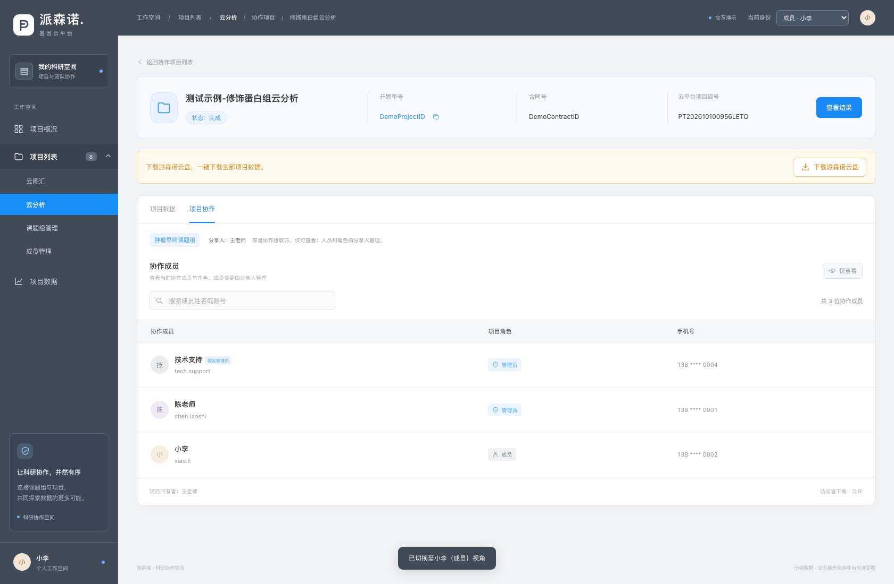
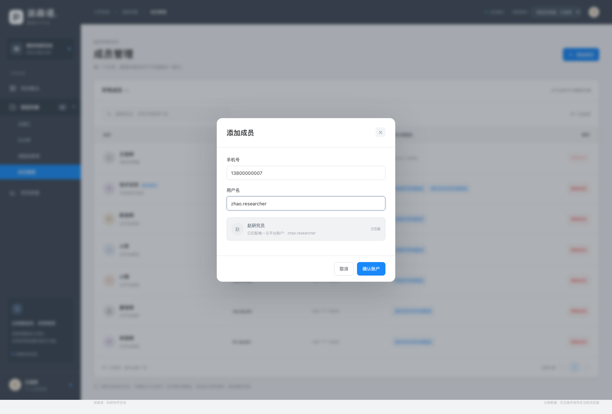

# 派森诺 · 科研协作空间

[打开在线交互原型](https://dafeiww.github.io/project-collaboration-prototype/?v=20261027-collab-perspective)

2026年10月27日更新。按参考截图采用深灰蓝导航与蓝色操作色。项目、课题组、成员页面不再显示顶部统计看板，保留业务列表和交互功能；桌面与手机均可体验。

## 可以体验的功能

- 左侧目录：项目列表为可展开父目录，二级依次为云图汇、云分析、课题组管理、成员管理。
- 项目列表：云图汇和云分析展示各自项目，均包含派森诺项目、共享项目、协作项目三个页签；按名称、编号搜索或按项目类别筛选。
- 项目字段：开题单号、合同编号、云平台项目编号、项目名称、所属类别、完整创建时间、状态；操作栏保留分享和协作项目，开题单号可复制或点击进入详情。
- 协作列表：只展示当前账号明确受邀参与的协作，不显示自己发起的记录；保持七个业务字段，无操作列，在项目名称下展示课题组和分享人，点击项目可进详情。
- 详情按入口区分：统一展示项目信息、查看结果、云盘下载提示及项目数据；只有从协作项目列表进入的详情额外包含“项目协作”。返回列表时保留来源页签。
- 接收方详情：可查看分享人、当前协作成员及其角色，不显示添加、移除、调整角色或权限开关；即使接收人在组内为管理员，也不能修改收到的项目。发起方通过派森诺项目中的“已协作”维护授权名单。
- 项目数据：支持示例文件夹的新建、名称校验、子目录浏览与确认删除；结果预览和客户端下载入口明确标注演示限制，不伪造分析文件或安装包。
- 项目协作：支持单项目和批量项目，课题组单选、组内成员多选；确认后仅更新当前列表的“已协作”状态，不跳转、不清空筛选。课题组页面发起时也留在原页面，接收人才能在自己的协作列表看到记录。
- 协作入口：主按钮移至表格上方工具栏、项目类别筛选旁，不再放在页面标题远处；勾选后显示“协作已选项目（数量）”。行内按钮根据真实记录区分“协作项目”和“已协作”，已协作时优先选中原课题组。
- 协作成员选择：标题和人数左对齐，“全选／清空”作为独立大按钮并排靠右，桌面高度40像素、手机44像素；统一卡片间距和成员信息对齐。仍可在同一名单选择、移除或撤销，保存生效，取消不修改授权，也不删除课题组成员。技术支持固定为管理员。
- 课题组：填写名称，成员下拉提示“输入手机号或用户名匹配云平台账户”，手机号和用户名唯一对应同一账户；可多选成员，也可当场添加，无需离开当前页面，返回保留组名、成员选择及角色。技术支持固定为管理员。
- 中文版添加成员：所有入口统一仅显示手机号、用户名，两者可互查；去掉说明横幅、示例账号、自动匹配标签和确认页重复说明，只保留字段、实际匹配结果、必要校验与操作。邮箱相关展示已在中文版隐藏，保留账户资料，并为后续英文版本预留邮箱入口。成员库不设置项目角色，加入课题组时再指定角色。
- 成员库移除：新增操作列和“移除成员”。未关联成员须确认后移除；有关联课题组、项目、协作授权或分享权限的成员，展示关联明细并禁止移除。项目所有者受保护，普通成员和访问者不可操作。仅移出成员库，不删除示例平台注册账号，刷新后仍可按原手机号重新添加。
- 项目共享：仅在派森诺项目列表发起，操作区区分“分享”和“已分享”；列表不显示“取消分享”。中文版分享弹窗可按手机号或用户名匹配同一用户并添加或移除，最多五人；校验无效账号、重复用户与项目所有者，取消弹窗不提交修改。“取消全部分享”仅保留在弹窗内，二次确认后收回分享权限，不影响协作关系。
- 身份切换：右上角切换项目所有者（王老师）、管理员（陈老师）、成员（小李）、访问者（小周），可体验发起与接收的不同视角；名单按每条协作的实际授权过滤，不因加入课题组就自动获得项目。
- 项目概况、项目数据和项目详情：均采用可操作页面，无截图覆盖区域。

## 使用说明

选择项目 → 发起项目协作 → 单选已有课题组或当场新建 → 确认成员 → 保存变更。

协作弹窗内可直接新建课题组，建组时可添加新成员，无需先去成员管理。创建后自动选用新组，确认协作前不授予项目权限。新协作默认全选组员；已有协作保留原授权，后续加组员不会自动扩大旧项目权限。

在课题组列表发起协作时，也可以在弹窗中单选或多选目标项目，保存后留在课题组页面。

演示收发流程：先用王老师选择肿瘤早筛课题组，勾选小李并保存；当前派森诺列表变为“已协作”。再从右上角切换“小李”，点击“协作项目”，即可查看分享人和只读成员名单。未勾选的人不会看到这条邀请。

已在成员库的示例手机号：`13800000005`（夏老师）。尚未入库的演示平台注册账号：`13800000007`（赵研究员）、`13800000008`（孙研究员）、`13800000009`（吴研究员），可体验账号匹配和新增流程。赵研究员对应手机号 `13800000007`、用户名 `zhao.researcher`。均为本地演示数据，不调用真实平台注册信息；旧版缺失邮箱只补示例邮箱，已有自定义邮箱保持不变。

这是使用示例数据的前端交互原型。演示操作保存在当前浏览器，各体验者之间互不影响，不会修改真实平台数据。

## 预览

## 本地打开与发布

直接用浏览器打开 `index.html`，或打开目录中的单文件 `项目协作-可转发原型.html`。

线上站点的实际发布来源为本仓库 **main 分支根目录**。修改后将 `index.html`、`styles.css`、`script.js` 提交至 main，等待页面构建完成并核对在线版本。

## 验证

本次更新已通过19项浏览器实际交互检查，详见 [协作收发与只读成员验收记录](协作收发与只读成员验收记录.md)。[账户互查与项目操作验收记录](账户互查与项目操作验收记录.md) 保留为上一轮版本历史，邮箱展示按本次中文版规则更新。[成员移除验收记录](成员移除验收记录.md)、[成员与建组流程验收记录](成员与建组流程验收记录.md) 和 [分享与详情验收记录](分享与详情验收记录.md) 保留作为版本历史。
