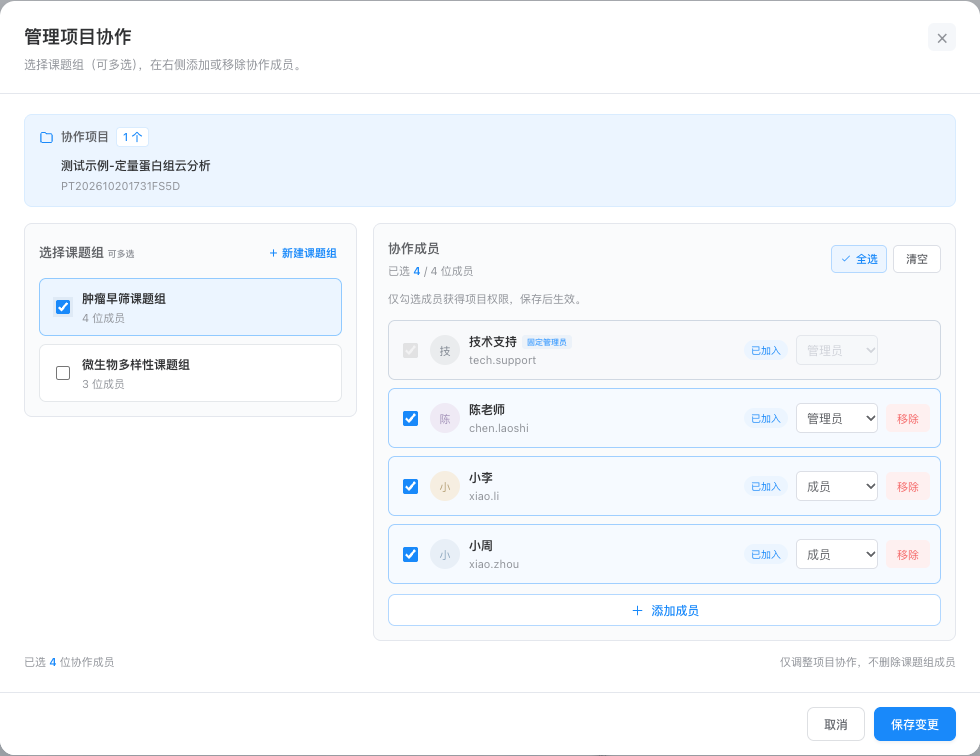
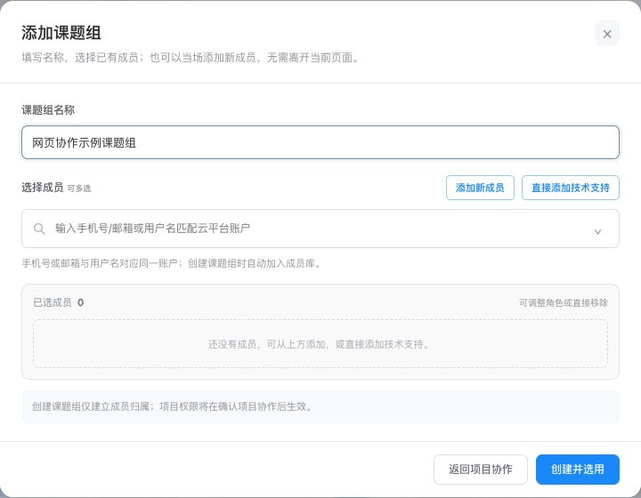
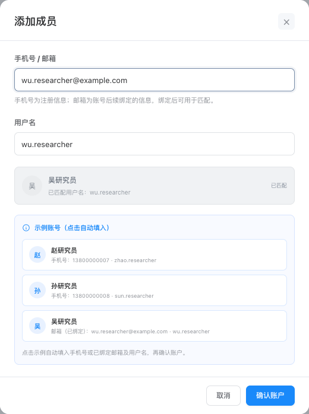
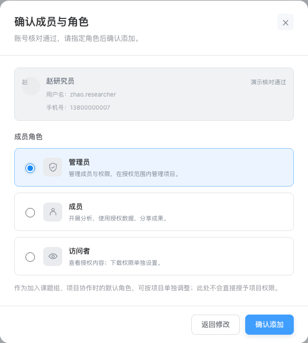
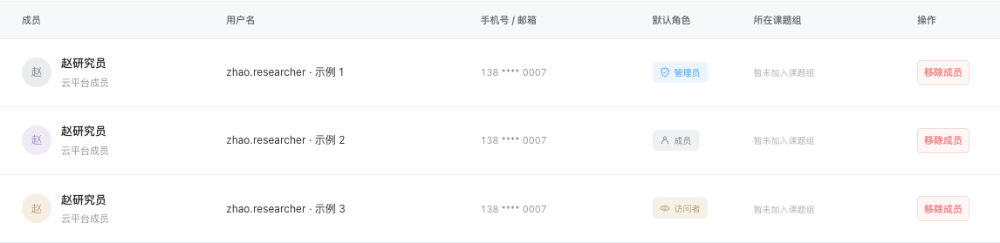

# 派森诺 · 科研协作空间

## 2026年11月3日：协作弹窗仅展示上一步所选项目

- 批量协作弹窗只带入当前项目列表中已勾选的项目，显示名称、编号、数量；不再显示所有可管理项目供重新选择。
- 未勾选项目时，点击“发起项目协作”提示先在列表勾选，不打开空弹窗，也不默认带入全部项目。搜索／类别筛选后只处理当前列表显示且勾选的项目。
- 单行“去协作／编辑协作”仅带入这一行的项目；课题组页面的“协作项目”先返回项目列表勾选，随后保留原课题组预选。
- 多项目的统一设置、各已选项目的单独设置，以及课题组全选、分组成员预览均保留；新增课题组、添加成员后也不会扩大本次项目范围。
- 取消弹窗不保存修改；未勾选项目的课题组、成员权限、分析记录不受本次协作影响。

## 2026年11月3日：精简导航与独立页面

- 所有角色的工作空间侧边栏删除“项目概况”和“项目数据”两个独立页面，连同独立页内容、卡片入口、渲染器一并移除，不只是隐藏导航。
- 项目列表中的“云图汇”保留为禁用占位，不能鼠标点击或键盘进入；旧入口不会重新打开该列表。技术支持仍仅显示原有四项导航。
- 三种角色均默认进入云分析／项目协作，不再自动落到云图汇。已删除页面的旧入口回到项目列表。
- 项目详情内的“项目数据”选项卡、协作列表，以及分析结果页的项目内概况保留，不删除项目、文件、协作授权或分析记录。
- 四份可转发单文件同步，项目协作、全选课题组、成员角色与分析记录删除权限保持不变。

## 2026年11月3日：分析记录删除边界复核

- 项目拥有者和获得项目管理授权的技术支持可删除本项目所有人的记录。
- 普通协作者只能删除提交人 ID 与自己一致的记录；即使课题组中为管理员，也不会根据展示身份获得删除他人记录的权限。
- 列表按钮、打开删除弹窗、最终确认删除三处均使用同一权限判断；访问者和仅共享查看的用户不可删除。修改记录名称仍仅限本人。
- 这仍是浏览器本地交互原型；正式服务端需执行同样的鉴权规则。

## 2026年11月3日：全选课题组与分组成员预览

- 单项目和多项目协作均可一键全选课题组、清空选择；部分选择时全选框显示半选。
- 右侧按课题组分组展示对应成员，可展开／收起；每组显示已选人数，总人数按账号去重。同一账号在多组中同步勾选、同步角色，不会重复授权。
- 新勾选的课题组自动带入成员；已手动取消的成员不因切换课题组重新获得权限。技术支持固定管理员，不可取消。
- 多个项目默认统一设置；点击具体项目名称可分别调整课题组、成员和角色，独立设置优先。保存前统一校验所有项目，不通过时不写入部分项目。
- 保存时每个课题组仅记录本组对应成员；弹窗直接添加的成员保留为项目直接授权，不会被混入所有课题组。项目整体协作成员合并去重，刷新保留。
- 所有选择均为草稿，取消弹窗不会改变原项目权限；已有协作记录不做自动清理。

## 2026年11月3日：项目详情协作列表与成员权限

- 已协作项目详情在“项目数据”旁显示“协作列表”，项目拥有者和已获管理授权的技术支持均可查看、添加成员、调整角色与移除成员。
- 管理权限以当前账号的实际项目授权为准；拥有者与已授权技术支持从共享项目进入自己的项目，也可维护协作成员。
- 普通协作者保持只读；仅收到原始结果分享、未获项目授权的用户不展示协作列表，也不能修改成员权限。
- 修改成员角色后同步到本项目协作记录，刷新仍保留；项目所有者不可调整角色，技术支持账号固定管理员。未协作项目仍隐藏协作列表。
- 技术支持四项导航、隐藏取消与重新协作、多人分析结果页与既有分析记录保持不变。

## 2026年11月2日：查看结果与分析记录

原型已接通“项目详情 → 查看结果 → 项目分析结果”，结果页沿用参考截图的深灰导航和右侧分析记录浮层。可从顶部“返回项目详情”返回，也支持浏览器前进、后退。当前项目编号、名称和登录视角随原项目带入。

- 协作项目默认展示“全部记录”，可切换到“我提交的”；同一分析章节同时显示多位提交人，记录标注姓名、项目身份、提交时间及“我”标签，并显示记录数与提交人数。支持名称／姓名／用户名搜索。
- 同一分析章节内保留不同用户的各次运行；每条记录显示“姓名＋项目身份＋时间”，明确区分项目管理者、技术支持及协作成员。增加“全部提交人”下拉筛选，按具体账号筛选；同名账号在选项中补充用户名。
- 新运行保存提交时的项目身份，后续身份调整不改写历史记录；此前未保存身份的记录按当前项目授权补充，并在详情中标明“当前项目身份”。
- 自动名称采用“分析方法－分组方案－序号”，允许提交时自定义名称，也可修改自己提交的记录名称。提交人按用户 ID 判断，与显示名分离。
- 分析记录按项目保存在当前浏览器中，切换账号后重新判断“我”；支持记录详情、删除确认、运行状态示例和记录汇总导出。
- 分析记录中的管理员身份统一显示为“技术支持”，历史记录、提交人筛选、详情及新提交均使用这一名称；技术支持可删除本项目所有人的记录。
- 分析记录列表按当前项目身份显示删除按钮：项目管理者和技术支持可删除本项目所有人的记录；其他协作者仅可删除自己的记录；访问者与仅通过项目分享进入的用户不能删除。列表显示权限提示，删除他人的确认框列出提交人，确认操作再次核对权限。修改名称仍只限自己的记录。
- 项目所有者、管理员及成员可演示提交分析；访问者和仅通过项目分享进入的用户保持查看权限。
- 新增 `项目协作-多人分析演示.html`，直接打开已协作项目的全部分析记录；原项目列表也提供“查看多人分析演示”入口。浮层底部可切换体验账号，分别提交后记录汇总在同一项目内。
- 旧版单人演示数据在当前项目已有授权范围内补充多人的独立运行，保留原记录和自定义名称；只补充一次，已删除的示例不会重新出现。
- 可转发单文件与多人演示文件已同步，无需额外脚本或样式文件。验收记录见 [查看结果与分析记录验收](20261102-分析记录与查看结果验收记录.md)。

[打开新版多人协作原型](https://dafeiww.github.io/project-collaboration-prototype/collaboration-analysis.html?v=20261103-selected-projects-only)

[从项目列表开始体验](https://dafeiww.github.io/project-collaboration-prototype/?v=20261103-selected-projects-only)

2026年10月29日更新。面向电脑浏览器的交互原型，沿用深灰蓝导航与蓝色操作色，统一项目协作、添加课题组、添加成员等网页弹窗。

## 本次样式优化

- 课题组选项按实际内容定高，列表从顶部紧凑排列，不再随右侧成员区域拉伸。
- 协作弹窗顶部显示所选项目的完整名称、编号及数量，支持单项目和多项目。
- “全选／清空”为28像素高的小操作按钮；新增成员和技术支持使用同一行的蓝色线框按钮。
- 弹窗统一标题、正文、边框、圆角和间距；较矮屏幕只滚动正文，取消与保存按钮保持可见。
- 中文版成员添加只有“手机号 / 邮箱”和“用户名”两个输入框：手机号为注册信息，邮箱为后续绑定信息，已绑定后才能用于匹配。英文版成员核对固定使用“邮箱 + 用户名”，不要求手机号。
- 操作列表头与按钮统一左对齐。技术支持在协作弹窗中固定选中且不显示移除按钮。

## 主要流程

1. 在云分析或云图汇的“派森诺项目”列表选择一个或多个项目。
2. 点击“发起项目协作”，选择一个或多个课题组；也可以在弹窗中直接新建课题组、添加成员。
3. 确认成员及角色后保存。同一项目可以对应不同课题组，多个项目也可以批量协作。
4. 顶部切换“被分享用户”，可查看收到的项目和成员信息；接收方没有添加、调整角色、移除等管理操作。

项目拥有者和已获管理授权的技术支持可在已协作项目详情查看并管理“协作列表”；普通受邀成员仅可查看，未协作项目隐藏该页签。

成员管理支持移除未参与协作项目或项目分享的成员，所属课题组本身不阻止移出成员库。移除须确认，平台示例账号保留，可再次添加；项目所有者受保护。

中文版项目分享支持按手机号、已绑定邮箱或用户名匹配已有账户，最多选择5位用户。取消全部分享需要确认，不影响协作授权。列表支持搜索、类别筛选、复制开题单号，以及进入项目数据与结果预览。

## 演示账户

| 用户名 | 示例手机号 | 邮箱与绑定状态 |
| --- | --- | --- |
| zhao.researcher | 13800000007 | zhao.researcher@example.com（已绑定） |

添加成员弹窗只展示赵研究员这一份示例。点击示例自动填入，或填写上述手机号／已绑定邮箱与用户名，均可反复添加同一个人，不设演示次数限制。每次确认生成独立成员记录，并标记“示例 1、示例 2……”；可分别设置角色、选择、移除，刷新后仍可继续添加。

成员管理、课题组添加、创建课题组内添加、项目详情添加，以及协作弹窗内添加使用同一套演示逻辑。重复添加仅放开这一示例账号；其他账户仍执行唯一匹配和防重复校验。这是本地原型的演示能力，不代表正式平台允许创建重复账户。

## 添加成员并指定角色

所有添加入口统一为“匹配账户 → 指定角色 → 确认添加”，可选择管理员、成员、访问者；技术支持固定为管理员。返回修改账号后，再次匹配同一账户会保留刚才选择的角色。

成员管理添加时保存默认角色，并在列表显示；从已有成员选择加入课题组时自动带入默认角色，也可单独调整。课题组内新增成员会按当场选择的角色加入当前课题组；项目详情和协作弹窗新增成员会使用所选项目角色。角色只在相应课题组／项目授权内生效，成员库的默认角色不会自动授予任何项目权限。重复示例的角色分别保存，刷新后不会互相覆盖。

角色流程验证见 [添加成员指定角色验收](20261029-添加成员指定角色验收记录.md)。

使用本地演示账户，不连接真实平台。交互操作只保存在当前浏览器，不同体验者之间互不影响。

## 网页弹窗预览

## 本地打开与发布

网页入口为 `index.html`。单文件 `项目协作-可转发原型.html` 可下载转发、直接在浏览器打开。

修改网页后运行 `python3 build-standalone.py` 同步两个单文件版本。GitHub Pages 发布来源为本仓库 **main 分支根目录**，提交并推送后等待构建完成。

本次浏览器流程验证见 [网页弹窗验收记录](20261029-网页弹窗验收记录.md)。此前验收记录保留作为版本历史。

## 2026年10月29日账户规则补充

中文版不提供“手机号版／邮箱版”切换按钮。用户在同一个联系信息输入框填写注册手机号或后续已绑定邮箱，再核对同一账户的用户名。系统不再为缺失邮箱的账户拼出示例邮箱；旧版自动生成的邮箱不会被当作已绑定邮箱。成员搜索、课题组选择和项目分享按同一绑定状态匹配。

英文版的成员信息规则随页面语言启用，固定为邮箱和用户名两个字段，允许没有手机号的账户。上述规则的验证记录见 [账户绑定规则验收](20261029-账户绑定规则验收记录.md)。

## 项目列表与团队管理更新

- 保留派森诺项目和共享项目，协作项目并入派森诺项目，开题单号后显示拥有者／协作者／访问者。
- 操作列协作在前、分享在后；保留去协作与编辑协作；取消、重新协作入口暂时隐藏，已有授权与历史数据不变。
- 技术支持只展示受邀项目；成员管理、课题组管理合并为同页页签，成员在前。

取消协作确认弹窗（本次暂隐藏，保留实现）展示受影响的人员名单：姓名、用户名、项目角色及本项目的课题组／直接邀请来源。同一人员跨课题组按一人展示，所有者不列入取消名单。名单可滚动核对，未确认前不变更任何授权。

派森诺项目列表最前新增 6 条从未协作的云分析示例，操作栏显示“去协作”。已有浏览器数据自动补齐缺失示例，不重置示例后续的协作状态。技术支持仍仅展示受邀项目。

本次临时收起取消协作、重新协作入口，同步移除相关引导文案；历史已取消项目仍保留记录和分享，不出现在批量发起协作选项中。已协作项目详情对拥有者和已授权技术支持显示项目数据与协作列表；普通受邀成员的只读范围保持不变。

技术支持的“项目管理”下按顺序展示“技术管理、技术人员管理、项目协作、协作人员管理”。前两项仅展示、不可打开；“项目协作”汇总受邀的云分析和云图汇项目，并保留共享项目；“协作人员管理”承接原成员与课题组页面。其他两种角色导航、权限和数据不变。
